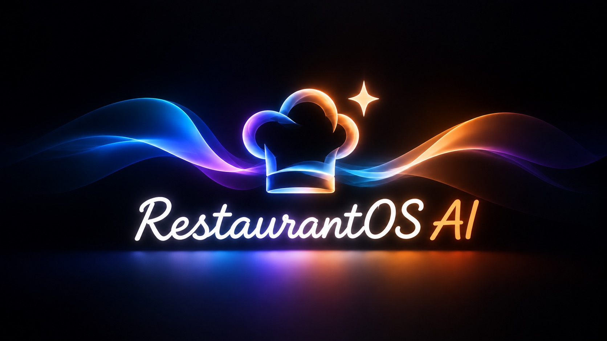

# RestaurantOS AI

**The AI General Manager for independent, multilingual restaurants.** An entry in the Meta Global AI Developer Hackathon 2026 (Startup track), built Oct 26 – Nov 4, 2026.

> **Status:** in active development during the hackathon. **Spice Route is a sample restaurant.** There are no customers, pilots or revenue.

## What it does (target for the submission)

- **Orders the way guests talk.** Guests order by phone or kiosk in Telugu-, Tamil- or Spanish-English. Meta's Muse Voice Transcribe hears them and Muse Spark turns each utterance into cart operations over a closed menu.
- **Tickets in each cook's language.** The kitchen display renders every ticket in the station's language from deterministic tables. No AI is involved in what a cook reads.
- **Sees the 86 coming.** Recipe-level inventory tracks reservations as orders land and forecasts when an ingredient runs out.
- **A governed AI General Manager.** When a shortage is coming, a rule-based playbook appears instantly and Muse Spark proposes a plan from options that code computed. Code owns every number. Low-risk steps run under policy, and anything consequential runs only after a manager approves those exact steps. Every step is written to a hash-chained ledger and can be undone.

## How it is built

- **Backend:** Python 3.12, FastAPI and SQLite (WAL).
- **Frontend:** React, TypeScript and Tailwind.
- **Meta Model API:**
  - Muse Spark 1.3 for structured order parsing and GM planning.
  - Muse Voice Transcribe, realtime and file, for speech recognition.
- **Spend control:** every paid call passes through a spend guard with hard caps, and tests replay recorded responses so they cost nothing.
- **Development:** done with AI coding agents (Claude Code), directed and tested by the two founders.

## License

Apache-2.0. See [LICENSE](LICENSE).
